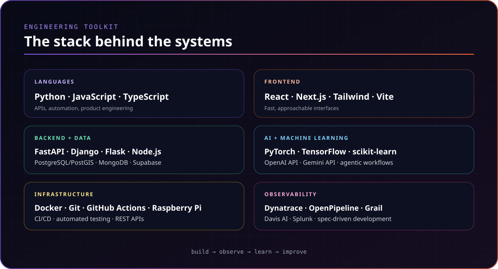
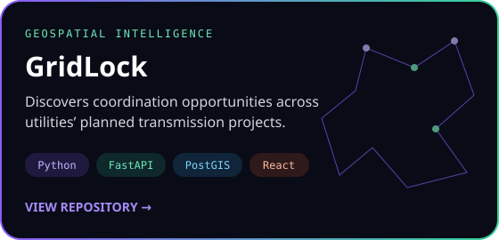
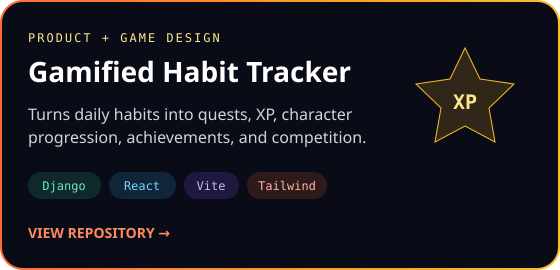
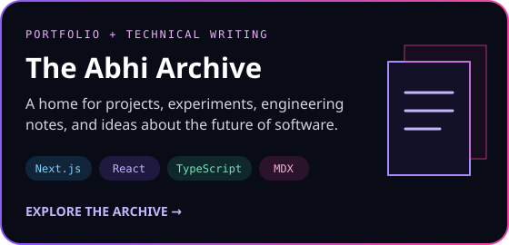
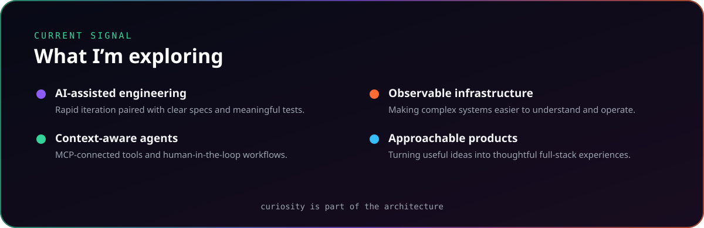

  <a href="https://abhiramcodegit.github.io/"><picture><source media="(max-width: 600px)" srcset="./assets/nav-portfolio.svg" width="48%" /></picture></a>&nbsp;
  <a href="https://abhiramcodegit.github.io/blog"><picture><source media="(max-width: 600px)" srcset="./assets/nav-blog.svg" width="48%" /></picture></a>&nbsp;
  <a href="https://www.linkedin.com/in/abhiram-bhogi"><picture><source media="(max-width: 600px)" srcset="./assets/nav-linkedin.svg" width="48%" /></picture></a>&nbsp;
  <a href="mailto:abhiram.bhogi@gmail.com"><picture><source media="(max-width: 600px)" srcset="./assets/nav-email.svg" width="48%" /></picture></a>

Building useful software. Exploring intelligent systems. Sharing what I learn.

 

 

### Featured builds

  &nbsp;
  

  &nbsp;
  

<a href="https://abhiramcodegit.github.io/projects">Explore the full project portfolio →</a> · <a href="https://github.com/Abhiramcodegit?tab=repositories">Browse public repositories →</a>

  

### Contribution signal

<a href="https://github.com/Abhiramcodegit"><picture><source media="(prefers-color-scheme: dark)" srcset="https://ghchart.rshah.org/c084fc/Abhiramcodegit" /><source media="(prefers-color-scheme: light)" srcset="https://ghchart.rshah.org/7c3aed/Abhiramcodegit" /></picture></a>

 

 

<strong>Accessible text version</strong>

## Engineering toolkit

- **Languages:** Python, JavaScript, TypeScript
- **Frontend:** React, Next.js, Tailwind CSS, Vite
- **Backend and APIs:** FastAPI, Django, Flask, Node.js, Express
- **Data:** PostgreSQL/PostGIS, MongoDB, Supabase
- **AI and machine learning:** PyTorch, TensorFlow, scikit-learn, OpenAI API, Gemini API
- **Infrastructure:** Docker, Git, GitHub Actions, Raspberry Pi, CI/CD, automated testing
- **Observability:** Dynatrace, OpenPipeline, Grail, Davis AI, Splunk

## Featured projects

- [GridLock](https://github.com/Abhiramcodegit/gridlock-sperry-hackathon): Geospatial coordination intelligence for utilities’ planned transmission projects.
- [Gamified Habit Tracker](https://github.com/Abhiramcodegit/gamified-habit-tracker): Daily quests, XP, progression, achievements, and a leaderboard.
- [Password Manager](https://github.com/Abhiramcodegit/password-manager-abhiram): Encrypted storage, JWT authentication, verification, and password generation.
- [The Abhi Archive](https://github.com/Abhiramcodegit/Abhiramcodegit.github.io): My portfolio, technical blog, projects, and engineering notes.

## Current interests

AI-assisted engineering, context-aware agents, MCP-connected tools, human-in-the-loop workflows, observable infrastructure, and approachable full-stack products.

